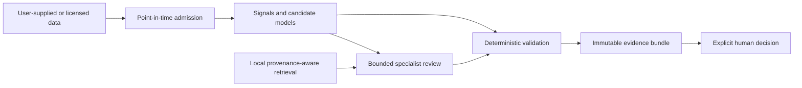

# Quant Lab

Quant Lab is an early-stage, evidence-first quantitative research framework for
testing model ideas, coordinating bounded specialist reviews, and preventing
fragile results from being promoted as trading evidence.

The repository is intentionally a research system—not a strategy, signal
service, or claim of investment performance. It combines deterministic Python
controls with optional model-assisted research while keeping validation and
promotion authority outside the models.

> **Research software only.** Nothing in this repository is investment advice,
> a recommendation, or authorization to trade.

Active scope, decided 20 November 2026, is Bursa Malaysia, China A-shares on the SSE and SZSE, and Hong Kong. Singapore, Indonesia, Japan, Korea, and the United States are frozen. The Beijing Stock Exchange stays out. See [`docs/DECISIONS_2026-11-20.md`](docs/DECISIONS_2026-11-20.md).

## What is included

- A typed Python research engine for data panels, signals, model tournaments,
  portfolio construction, transaction costs, and capacity checks.
- Point-in-time data contracts and fail-closed admission controls.
- Walk-forward, purge/embargo, CPCV/PBO, probabilistic/deflated Sharpe,
  multiple-testing, holdout, and stress-testing utilities.
- `QForge-20`, a bounded adversarial workflow with twenty configurable
  PhD-level mathematical review roles.
- A local provenance-aware retrieval layer using SQLite FTS and vector
  embeddings, plus an allowlist-first Cerebras reference integration.
- Hash-chained experiment state, deterministic evidence gates, and optional
  signature-verification boundaries for independent validation and human
  approval.
- Examples and a broad automated test suite.

“PhD-level” describes the depth and obligations of each software review role;
it does not claim that an agent holds a degree or that twenty independent
humans or foundation models are present.

## Architecture



Models may propose, interpret, and challenge. They cannot manufacture accepted
evidence, change a failed gate, access trading authority, or approve their own
work.

## Quick start

Requirements: Python 3.10+ and [uv](https://docs.astral.sh/uv/).

```bash
git clone https://github.com/BQ13333/quant-lab.git
cd quant-lab
uv sync --extra agents
uv run pytest
uv run python examples/run_tournament.py
uv run python examples/run_agent_workflow.py
```

The sanitized public snapshot has been verified with **1,130 passing tests**.
Another 78 integration tests are explicitly skipped because they require
licensed/private market-data or research-corpus artifacts that are not
redistributed with the project.

Optional adapters require their own dependencies, credentials, entitlements,
and data licences. See `pyproject.toml` and the relevant documents under
`docs/`.

## QForge-20 and the specialist panel

`QForge-20` treats model output as a research proposal rather than proof. It
requires predeclared budgets, isolated first opinions, adversarial challenges,
reproducible counterexamples, deterministic gates, and terminal-holdout
separation.

- Workflow: [`docs/QFORGE_20_WORKFLOW.md`](docs/QFORGE_20_WORKFLOW.md)
- Specialist panel: [`docs/PHD_MATH_SPECIALIST_PANEL.md`](docs/PHD_MATH_SPECIALIST_PANEL.md)
- Role registry: [`configs/phd_math_specialists.json`](configs/phd_math_specialists.json)
- Control plane: [`docs/RUN_CONTROL_PLANE.md`](docs/RUN_CONTROL_PLANE.md)

This is an advanced architecture under active development, not a verified
“state-of-the-art” performance claim. Benchmark cards state their scope and
non-goals explicitly.

## Local retrieval and Cerebras integration

The knowledge-completion module builds a content-addressed local index of
authorized research artifacts with:

- exact provenance and SHA-256 bindings;
- FTS and optional embedding search;
- deterministic chunk and embedding checks;
- duplicate and policy controls; and
- local-only search by default.

The reference adapter under
[`integrations/cerebras_rag/`](integrations/cerebras_rag/) adds allowlist and
deny-term enforcement, macOS Keychain credential loading, Cerebras-generated
structured labels, reranking, cited synthesis, a local run ledger, and a
separate grounding-verification step. Full text and embeddings remain local;
only explicitly eligible evidence is sent to the provider.

The public repository includes the integration code—not a hosted service,
private knowledge base, commercial books, credential, or historical model
prompts and responses. See the integration README for its exact security and
licensing boundary.

## Public-release boundaries

This repository does **not** include:

- proprietary or licensed market data;
- commercial books, PDFs, or OCR-derived book text;
- credentials, API keys, broker access, or live-order functions;
- private experiment artifacts or model conversations; or
- a claim that any included strategy is production-ready.

Some integration tests require a separately supplied, legally obtained corpus
or licensed data and are skipped unless their explicit environment variables
are configured.

## Contributing and security

See [`CONTRIBUTING.md`](CONTRIBUTING.md) for development guidelines and
[`SECURITY.md`](SECURITY.md) for responsible disclosure. Please do not submit
datasets or source material that you lack permission to redistribute.

## License

MIT. See [`LICENSE`](LICENSE).
