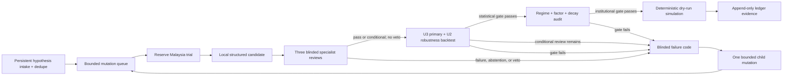

# Local Ollama Malaysia Research Loop

> **Current baseline:** This document describes the implemented local-only
> runtime. The approved successor architecture is **QForge-20 — the Bounded
> Adversarial PhD Quant Research Workflow**, documented in
> [`QFORGE_20_WORKFLOW.md`](QFORGE_20_WORKFLOW.md). Its direct provider,
> cloud-sanitization boundary, cost controls, and first bounded Malaysia V4-Pro
> review wave are implemented. This local loop remains the zero-hosted-cost
> planning and research baseline.

This system runs finite, Malaysia-only quantitative research batches on local Ollama. Codex may inspect and improve the engineering, but it is not a runtime dependency. No hosted model provider, API key, broker connection, or live-order function is part of the loop.

## What the loop does



The controller is a bounded batch service, not an infinite process. Continuous operation comes from a supervisor scheduling completed finite batches.

## Institutional hypothesis intake

Every root hypothesis must first enter `HypothesisIntakeRegistry`. The registry persists the full typed ticket, an exact content hash, and a deterministic semantic fingerprint in the campaign SQLite database. It rejects exact duplicates and reordered near-duplicates before an Ollama call consumes compute. A semantically similar child is allowed only when its parent is already admitted and the child carries explicit blinded mutation codes.

Tickets are Malaysia-only and must declare a falsifiable economic claim, one allowlisted family, the frozen feature set, a one-to-252-day horizon, U3/U2 scope, and concrete data requirements. Japan, hosted routing, terminal-result language, and broker/order scope are rejected. The controller requires an admission registry and checks it both at construction and before reservation; a raw queue entry cannot bypass intake.

The intake registry, trial ledger, and evidence store live in one shared Malaysia lifetime vault. Completed older campaign ledgers are imported only after every trial is terminal; evidence hashes, corrections, and parent lineage are verified and preserved. New campaigns never start with a reset trial denominator.

## Local model routing

The only approved endpoint is `http://127.0.0.1:11434`. The endpoint validator rejects HTTPS, non-loopback hosts, credentials, query strings, fragments, and nonstandard ports. There is no hosted fallback.

| Capability | Local model |
|---|---|
| Candidate extraction and routine review | `qwen3.5:35b-mlx` |
| Final adversarial mathematical review | `deepseek-r1:70b` |
| Bounded code implementation tasks | `qwen3-coder:30b` |

Check local readiness:

```bash
ollama list
curl -fsS http://127.0.0.1:11434/api/tags
```

The expected names must appear exactly. If a model is absent, install it using the corresponding command shown by its Ollama library page. Do not add provider credentials to the repository or environment for this workflow.

Every call uses structured JSON, `think=false`, an 8,192-token context, bounded output, one to three attempts, and a finite timeout. The ledger stores model/provider identity, timing, token counts, stop reason, and prompt/schema/config/response hashes. It never stores prompt or response bodies.

Configuration is in [`configs/local_model_routing.json`](../configs/local_model_routing.json). The provider implementation is in [`src/quant_lab/research/providers`](../src/quant_lab/research/providers).

## Malaysia universe and features

The campaign has one fixed market scope:

- Market: Malaysia.
- Exchange: Bursa Malaysia (`.KL` instruments only).
- Primary portfolio universe: U3, exactly 34 stocks.
- Robustness universe: U2, exactly 62 stocks; U3 must be a subset.
- Base cost: 20 bps one-way.
- Stress cost: 40 bps one-way.
- Permitted feature families: price, volume, volatility, and lagged liquidity.

Candidate parameters are evaluated unchanged on U3 and U2. The controller cannot select the better-performing universe. The accepted tier source used by the pilot is:

```text
artifacts/codex_backtests/CODEX_ASEAN_L2_DEEP_20260707/
  05_l2_deep_extraction/ASEAN-L2-DEEP-MYS-SGP-IDN-20260708/
  eligible_universe_tiers.csv
```

`MalaysiaUniverseContract` validates country, suffix, counts, uniqueness, subset relation, and source hash before any trial begins.

## Research validation versus terminal promotion

Historical data through 2026-07-06 is research or contaminated-audit evidence. It is not a pristine holdout. Candidate generation, ranking, specialist review, mutation, and parameter selection receive research-period evidence only.

Research progression jointly requires:

- three structurally valid specialist reviews, including selection-bias review;
- no concrete-counterexample veto;
- positive net out-of-sample information ratio;
- deflated-Sharpe probability at least 0.95 using the lifetime trial denominator;
- PBO no greater than 0.20;
- maximum drawdown no worse than -20%;
- annualized turnover no greater than 3.0;
- positive net IR under 40 bps one-way stress;
- maximum asset weight no greater than 25%;
- positive U2 robustness net IR;
- at least three predeclared causal regimes with at least 63 observations each;
- positive performance in at least half of eligible regimes, no more than 80% of positive P&L from one regime, and worst regime IR no lower than -1.0;
- factor-adjusted IR of at least 0.25, factor R-squared no greater than 0.80, and Newey-West factor-adjusted alpha t-statistic of at least 1.0;
- positive latest rolling Sharpe over both 126 and 252 research observations.

Raw Sharpe is recorded for diagnosis but cannot promote a candidate.

Review has two permissions. A `conditional` review may authorize the historical backtest needed to run its falsification tests, but it remains a blocking research code afterward. Only a unanimous `pass` panel can reach institutional audit, and the audit gates must still pass before deterministic dry run. Model-authored review drafts contain judgment fields only; the controller owns task identity, evidence, and provenance.

The regime labels are causal: lagged 126-day market trend and lagged 63-day volatility are compared with expanding, lagged volatility thresholds. No hidden Markov model is repeatedly fitted until a pleasing classification appears. Factor decomposition uses only factors supported by the Malaysia dataset: equal-weight market, cross-sectional momentum, low volatility, and lagged liquidity. It does not invent unavailable Malaysia value or size histories, and a repackaged factor exposure fails the residual-alpha gate.

The 126/252-day decay check is a campaign-time historical stability gate. Ongoing paper-alpha decay cannot be calculated until a future dry-run service has accumulated realized paper returns; the simulator never fabricates that evidence. When those observations exist, they must be appended as a separate `decay_monitor` ledger event and assessed before the next finite campaign can promote anything.

A one-time terminal holdout is a separate service and may use only observations strictly after 2026-07-06. It may emit a terminal pass/failure receipt after a candidate is frozen. It cannot rank candidates, create mutation instructions, or expose numerical results to the research loop.

## Lifetime ledger and legacy denominator

`TrialLedger` reserves identity before candidate extraction or backtesting. Every trial records code, data, config, prompt, and model hashes, parent lineage, append-only events, and content-addressed evidence. SQLite WAL, immediate reservations, unique idempotency keys, and evidence hash verification make concurrent writes and replay safe.

The known `MALAYSIA-SWEEP-20260705-085432` campaign contributes 3,330 immutable legacy attempts. Import is idempotent and rejects a conflicting manifest:

```python
ledger.import_legacy_malaysia_sweep(
    "artifacts/malaysia/MALAYSIA-SWEEP-20260705-085432/sweep_manifest.json"
)
```

The shared vault reports the current lifetime denominator at run time. Never copy a campaign database into a fresh directory and treat it as a new denominator; use the verified completed-ledger importer.

## Run one finite campaign

Start with one trial and one generation:

```bash
uv run python examples/run_bounded_malaysia_pilot.py \
  --campaign-id MALAYSIA-OLLAMA-PILOT-002 \
  --max-trials 1 \
  --max-generations 1
```

The campaign ID is path-safe and must match `MALAYSIA-[A-Z0-9_-]+`. The first campaign is hard-capped at 10 hypotheses, three variants per hypothesis, 30 new trials, three generations, and explicit family/token/external-cost/wall-time/consecutive-failure limits.

For round-the-clock operation, schedule finite campaigns rather than running `while true`. `FiniteCampaignSchedule` emits at most four non-overlapping run receipts per day, each with a trial cap and a requirement that the preceding campaign reached a terminal state. A supervisor may invoke the runner from those receipts, but it must not start overlapping campaigns or relax a gate after rejection.

```bash
uv run python examples/plan_bounded_malaysia_schedule.py \
  --start-at 2026-07-14T00:00:00+08:00 \
  --campaign-count 4 \
  --interval-hours 6 \
  --max-trials 3
```

Campaign state is written under:

```text
artifacts/bounded_malaysia_loop/<campaign-id>/
```

The cross-campaign ledger and content-addressed evidence are written under:

```text
artifacts/bounded_malaysia_loop/_malaysia_lifetime_vault/
```

This path is ignored by Git. Do not commit campaign databases, evidence, model outputs, or generated experiment notes.

## Dry-run meaning

The dry-run layer is a pure deterministic calculation. It accepts frozen target weights and reference prices only after every research gate passes. It emits simulated fills or rejection reasons, quantities, fill prices, slippage cost, fee, and a configuration hash.

It has no broker authority: no account identifier, broker client, network connection, `submit_order`, `place_order`, or transmission method. A dry-run result is not paper-trading authorization and never live-trading approval.

## Offline replay walkthrough

CI uses deterministic fake and replay providers, so no model server is required:

```bash
uv run pytest -q \
  tests/test_model_providers.py::test_offline_replay_is_content_addressed_and_deterministic \
  tests/test_bounded_research_loop.py::test_replay_has_identical_transitions_and_artifact_hash \
  tests/test_bounded_research_loop.py::test_two_iterations_consume_blinded_mutation_and_preserve_parent_lineage
```

Expected result: three tests pass. The first reproduces a structured contract from a request fingerprint. The second reads the persisted campaign state twice and obtains identical transitions and artifact hash. The third proves iteration two consumes iteration one's blinded mutation code and preserves trial/candidate parent lineage.

For an existing live campaign, rerun the exact same command and configuration. Completed candidate and specialist events are reconstructed from the ledger; the controller does not call those roles again. Configuration drift stops resume.

## Source map

- Contracts: `src/quant_lab/research/contracts.py`
- Trial/evidence ledger: `src/quant_lab/research/trial_ledger.py`
- Validation firewall: `src/quant_lab/validation/firewall.py`
- Terminal holdout service: `src/quant_lab/validation/terminal_holdout.py`
- Ollama provider and replay: `src/quant_lab/research/providers/`
- Twenty role definitions: `configs/phd_math_specialists.json`
- Blinded review runtime: `src/quant_lab/agents/specialist_runtime.py`
- Bounded controller and dry run: `src/quant_lab/research/bounded_loop.py`
- Historical Malaysia adapter: `src/quant_lab/research/malaysia_pilot.py`
- Institutional intake, audit, and finite schedule: `src/quant_lab/research/institutional_workflow.py`
- Operator recovery: `docs/MALAYSIA_LOOP_RECOVERY.md`
