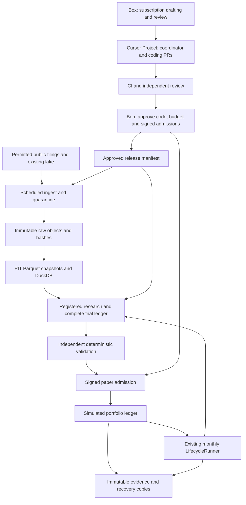

# Cloud Production Blueprint — Quant House Lab

Prepared for Benjamin Quek · 20 November 2026 · Asia/Kuala_Lumpur (MYT).

This is the reconciled production blueprint for running the quant **lab** fully in the cloud. Astra drafted it, Fable red-teamed it, Astra completed one fix pass, and the executor reconciled arithmetic, sources and wording. Working papers stay in `_work/`. Architecture exhibit: `architecture.png` / `architecture.svg` (D2, diagram_kit). [S: `_work/BRIEF.md`, `_work/FABLE_REDTEAM.md`, `_work/ASTRA_DRAFT_V2.md`, `_work/FLASH_FACTS.md`, `_work/SOURCES_GROK.md`]

**Reading convention.** [S] means supported by the attached file path or linked primary source, not independently certified. [A] means proposed design, operating target, assumption or calculation from stated inputs; it is not implemented or approved. [U] means unresolved or not verified. Tags apply to the paragraph, list item or table row they introduce. Local source aliases below resolve to exact paths in §11. Prices use the supplied 20 November executor-verified sources; this revision does not claim a fresh vendor audit. Reconfirm the region-specific checkout before any purchase. No deployment or spending is authorized by this document. [A]

## 0. Executive summary

**Recommend Parquet + DuckDB + systemd + Healthchecks + public GitHub Actions**, retaining both repositories and existing validation/lifecycle contracts. Phase 1 stays on the existing box at **USD0 incremental**, within existing entitlements. After the feasibility gates and Ben's GO, try **Oracle A1 Always Free first**, then **Hetzner CX23**, and use **Lightsail 8 GB only after written failures on both alternatives for reachability, stock or RAM**. Storage is private **R2 primary plus an independent Backblaze B2 copy**. [A; prices: §3]

**Scope: MY/CN/HK, lab only.** Bursa, SSE/SZSE A-shares and HKEX simulated portfolios; no live trading, broker code, order routes, crypto, US or HFT. CNY/HKD research remains separate. Continuous discovery, rejection, monitoring and replacement is the objective; persistent profits are not promised. [S: B, K; A]

**Modeled monthly services: USD1.98 / 12.36 / 70.59 low/base/high**, or **RM8.14 / 50.83 / 290.30**, using BNM's **4.1125 KL USD/MYR reference rate, 20 November 2026**. These are conditional scenarios with 100/250/1,000 GB at each storage provider, not approved budgets or all-in bills. Tax, B2 transactions and account-specific transfer/FX charges remain [U]; no arbitrary reserve is added. Phase 1 has no new service bill. [A calculations: §3; S: G, F, executor additions]

**Cloud spend is held.** Phase 1 must exit with at least one market's historical cost intervals and usable price/universe evidence, a dated per-instrument HK lot table, and a named human root holder/deploy path. The selected candidate must pass a probe from its actual egress IP. If obtaining that IP requires paid provisioning, the gate remains blocked: this document grants no trial-spend exception. Free provisioning still requires explicit account/deploy GO. [A]

**Four phases:** reconcile and establish feasibility on the box; after GO provision and restore; prove shadow operations including recovery and calendar edge cases; admit a qualifying simulated sleeve and monitor using the existing monthly lifecycle. No qualifying sleeve is an acceptable result. One monthly cycle checks operation, not statistical detection power. [A]

**Immediate decisions:** retain the five kickoff recommendations (scope correction; conditional isolated Ziplime trial; HOLD both PR #1 merges; preserve US archives/Japan dormant; official filings without paid feeds). Ben is the proposed human root/key custodian and source-rights owner, subject to his explicit acceptance before spending. No agent can gain root, replace trust anchors or sign admissions. §9 lists the decisions and blockers. [A]

**Red-team disposition:** accept the substantive cost, backup, stage, feasibility, trust, source, CI, fencing and selection findings. Lightsail prices and CX23 FI/DE availability are now source-supported by executor additions, resolving those earlier uncertainties without proving stock. No smaller lake size is claimed: D is a sampled inventory with overlap, not a measured deduplicated footprint. The v1 heredoc issue was already removed. Detailed dispositions and remaining limits are in §11. [S: FABLE, D, executor additions; A]

## 1. Current state and what moves to the cloud

| Component | Evidence and treatment |
|---|---|
| Public `BQ13333/quant-lab` | [S: K] Public framework; PR #1 is reported open at `f13073b1d1344beb9d7d9b0deedb44dd7dff84ef`, targeting `main`. Contains lifecycle, validation fixes, market rules and simulated paper engine. [A] Deploy only an explicitly approved commit after integration review; do not build replacements. |
| Private `BQ13333/08-quantitative` | [S: K, P08] PR #1 is reported at `30816df3a9a3830328437b27b6e9e2113889069b`, targeting `outbox/box`, not `main`. The supplied local tree is a partial extract. [A] Keep private data/campaigns private; obtain an authorized full checkout for eventual integration tests. |
| Tests and contradictory receipts | [S: PQL, VS] Public PR body records 1 failed / 1,320 passed / 78 skipped; later v3 status records 1 failed / 1,325 passed / 78 skipped after decision tests. Both identify the Japan quotations failure. [U] Neither is a fresh result from this drafting task or proof of today's remote head. [A] Re-run the approved integrated tree and retain exact test IDs. |
| Private testing | [S: P/BUGFIX_REVIEW_RESULTS.md] Partial-extract review reports pre-existing failures and setup errors, plus a missing `verify_tracked_surface` script. [A] Targeted fixes do not establish a clean full private deployment. Missing mandatory evidence remains blocking. |
| Scope | [S: Q/configs/project_market_scope.yaml] YAML activates several excluded markets and excludes China. [A] Reconcile YAML, adapters, queues, docs, CLI defaults and fixtures; runtime admission must independently allow only MY/CN/HK. |
| Lake | [S: K] Private `china_lake` already contains HK and A-share verticals, PIT master and tradeability guards; `MY_Alpha_Lab` contains research waves. Some CN ST status is inferred and Connect sell-only distinctions are missing. [A] Preserve lineage, audit and adapt; do not re-extract the lake. |
| Drive | [S: D] Roughly 19 GB resident tars plus 41 GB archive tars; DuckDB file 96.5 MB. It is an October snapshot, not a live mirror; unpacked and packed data overlap. [S: ST] Quant House folders later moved under `10 Quant House`, with file IDs retained. [A] Migrate by ID and content hash, not title or latest folder timestamp. |
| Archives | [S: VS] US code archive is `/workspace/quant_house/_archive_not_in_use/`; the Mac US data archive is `/Users/benjyq/Downloads/Investment_Banking_MD/_archive_not_in_use/`, reported at 151 GB. [A] Preserve both outside active git/lake queues; distinguish code archive from data archive. Do not assume the Mac archive exists in Drive. |
| Box and agents | [S: B, R] Box hosts Grok orchestration and subscription-authenticated Claude Code/Codex CLIs; Cursor Project coordinates GitHub coding agents. [A] Keep drafting, review and optional isolated experiments there; keep Phase 1 on it, then move durable scheduling, admitted runtime state and lake authority off it after all spend/deploy gates pass. |
| Ziplime | [S: Z, R] Version 2.12.0 already installed in `/workspace/tools/ziplime/.venv`; no ingest/backtest was performed in the reported smoke. `lime-trader-sdk` is installed transitively. [A] Its presence is not permission to import or use it; do not connect the unsandboxed MCP runner. |

The 15 November blueprint's new-repo migration, live milestones, US/crypto strategies, paid feeds and broker architecture are superseded. Reuse its bitemporal storage, reproducibility and validation lessons only where consistent with current contracts. The older department document also contains stale scope and unbuilt-maths claims; it supplies a role taxonomy, not authority to redo PR #1 or change thresholds. [S: B, OLD, Q/docs/MULTI_AGENT_QUANT_SHOP_BLUEPRINT.md; A]

## 2. Target architecture

### 2.1 Runtime and authority

Proposed flow; all arrows denote files or deterministic job handoffs, never an order route. Official exhibit: [`architecture.png`](architecture.png) (D2, house kit). The mermaid sketch below is a working copy of the same flow. [A]

| Layer | Recommended implementation and ownership |
|---|---|
| Compute | [A] Phase 1: existing box, no new spend. After GO: Oracle A1 Always Free (2 OCPU/12 GB; capacity/home-region risk), else Hetzner CX23 (2 vCPU/4 GB/40 GB, FI/DE; stock and source-reachability risk). Lightsail 8 GB is conditional on written failure evidence for both. One heavy process; separate ingestion, research, deterministic validation and publisher users; root-owned releases; no agent sudo, admin keys or container socket. Disk is a bounded cache. [S: F, G, executor additions; §3 comparison] |
| Sizing | [A] Benchmark a fixed admitted snapshot through ingest, PIT join, largest registered feature/backtest, validation and checkpoint. Record peak RSS, spill bytes, free disk, elapsed time, CPU throttling and request counts for three cold/warm runs. Proposed pass: no OOM; peak RSS below 75% RAM; at least 20% disk free; daily chain finishes before its next decision deadline; weekly heavy job within 6 hours. Test ARM dependency parity on A1. An 8 GB request requires a repeatable CX23 4 GB RAM/deadline failure after pruning/spill tuning, an A1 stock/reachability failure (A1 already has 12 GB), and an 8 GB replay demonstrating success. Reachability/stock can justify the provider fallback, but do not themselves prove a need for 8 GB. No automatic upgrade. |
| Scheduler | [A] systemd `OnCalendar` timers with `Persistent=true`, watchdog and bounded restart policies invoke existing Python entrypoints. A small private orchestration wrapper records dependencies, locks, deadlines, attempts and commit receipts. No Dagster/Airflow cluster initially. [S] Persistent timers catch missed activation; they do not implement a complete multi-period backfill queue ([systemd](https://www.freedesktop.org/software/systemd/man/latest/systemd.timer.html)). |
| Lake | [A] R2 Standard private buckets: incoming/quarantine, admitted raw/curated and evidence; Backblaze B2 holds the independent full retained copy. Immutable SHA-256 object names; Parquet/Zstandard, Hive-style partitions by dataset, market, source, year/month. Raw PDFs/HTML remain original bytes. Snapshot manifests explicitly list objects and schema versions. Start without Iceberg or a managed catalog. [S] DuckDB supports Hive partitioning ([docs](https://duckdb.org/docs/current/data/partitioning/hive_partitioning)). |
| PIT database | [A] DuckDB over immutable Parquet plus a rebuildable local catalog; retain the existing China catalog as an archived input and validate mappings before replacement. Single publishing writer; workers use independent read-only snapshot/catalog copies. No shared writable DuckDB file on object storage. [S] DuckDB's documented ordinary write model is a single writer process ([concurrency](https://www.duckdb.org/docs/1.4/connect/concurrency)). |
| Experiment tracking | [S: Q/docs/RUN_CONTROL_PLANE.md] `ExperimentRunStore`, immutable manifest versions and hash-chained events remain authoritative. [A] Export an artifact index and weekly HTML/Markdown reports initially. MLflow is optional, private, single-writer, with a local SQLite index rebuilt from canonical artifacts; it cannot approve a run or replace trial accounting. |
| CI | [A] Public GitHub Actions: synthetic fixtures, unit/regression tests, scope/no-broker import checks, reproducible build, dependency/secret scan. Private CI: authorized fixtures and contract integration; no lake data in any Actions artifacts. Set USD0 Actions spending limit; no self-hosted runner on the public repo; no secrets on fork PRs (including privileged workflows checking out fork code). Pin actions by SHA, lock dependencies, restrict token permissions, timeouts and concurrency. |
| Release/CD | [A] CI produces digest-pinned artifacts; Ben approves an exact release manifest containing both repo commits, container/lock hashes, contracts, policies and migrations. An administrator deploys it with a recorded GO. No automatic main-to-production deploy. Roll back code only with compatible state; replay rather than silently downgrade schemas. |
| Secrets | [A] Separate source/storage tokens, validation signer and notification credential. Human approval private key stays with Ben, outside cloud agents and runtime. Never put plaintext tokens in `.env`, shell history, images, CLI arguments or box files. Encrypted credential handling and acceptance tests below are mandatory. |
| Monitoring | [A] Structured redacted logs, daily freshness/coverage/cost report, per-job external heartbeat and monthly lifecycle report. Use Healthchecks.io Hobbyist within its published 20-job allowance, after GO; no paid observability stack initially. [S: https://healthchecks.io/pricing/] |

**Publication and replay contract.** Each job key includes task, market, source window, input-manifest hash, code/config hash and policy version. Write temporary outputs locally; validate schema/hashes; upload immutable data; then publish a complete manifest. Downstream jobs consume only a committed manifest, never an object-prefix listing or a mutable “latest” glob. A retry returns the existing matching result or creates a separately identified failed attempt; it cannot duplicate fills, trials or monthly transitions. [A]

The existing local run-control store already uses file locking, fsync and immutable versions; lifecycle `EventStore` uses a locked JSONL append with fsync and continuity checks. These are local filesystem guarantees, not a distributed object-store transaction. Keep one active state writer. After every authoritative transition, checkpoint its evidence and state hash remotely before dependent work proceeds. A crash before remote publication leaves the transition unacknowledged; recovery reconciles the journal/manifest and never fabricates a successful receipt. External daily head hashes help detect truncation: a hash chain alone cannot detect deletion of its last events without a separately retained head. [S: Q/docs/RUN_CONTROL_PLANE.md, Q/src/quant_lab/lifecycle/events.py; cloud wrapper/anchoring: A]

**Writer fencing primitive.** [A] Use one root-managed publisher service on one active host. It holds an exclusive nonblocking `flock` on a persistent local lock file for its lifetime; only that service identity can mutate local journals or publish canonical remote checkpoints. Workers submit candidate files without publication credentials. A root-owned monotonically increasing writer epoch is included in every manifest/receipt and checked by consumers against the human-approved release epoch. Local locking is not distributed fencing: takeover is manual and fail-closed. Before incrementing the epoch, Ben must stop/power off the old host, revoke its R2/B2 publisher credentials, verify denial with those credentials and reconcile the remote head. If revocation or shutdown cannot be verified, no replacement starts. Then issue fresh credentials and restore the reconciled state. Test concurrent process exclusion, stale-epoch rejection and a partitioned old host attempting to publish after takeover. No lease expiry or network timeout authorizes automatic failover.

**Heartbeat allocation: 16 of 20 jobs.** [A; allowance S: F, https://healthchecks.io/pricing/] Per market, three aggregated checks (acquisition-window completeness, PIT/coverage QA, paper reconciliation) = 9. Shared checks: scheduler watchdog, publisher/checkpoint, B2 replication, weekly research ledger, monthly lifecycle, restore drill, weekly cost/security review = 7. Each aggregate checks all expected child receipts; a skipped child cannot yield green. When no sleeve is admitted, the paper check reports an explicit expected idle state. Calendar-aware deadlines distinguish exchange closures from missing sessions. Ben must choose the alert destination, responder and escalation window before unattended operation (decision 11); no route is configured here.

### 2.2 Scheduling and bounded work

Cadences and deadlines below are operating proposals, not exchange opening-time claims. Use each market's versioned session calendar; the Asia/Kuala_Lumpur scheduler clock does not imply that all markets share holidays. [A]

| Cadence, MYT | Job and fail-closed behavior [A] |
|---|---|
| Daily 19:30 | Acquire permitted EOD observations and disclosure deltas. Date-window overlaps plus document hashes catch revisions. Daily scans include weekends for disclosures, while prices use session calendars. |
| Daily 23:30 and 07:00 | Catch late disclosures; create an explicit 07:00 decision cutoff for any next-session paper calculation. Information arriving after cutoff waits until the next registered decision. No same-close use of later disclosures. |
| Daily 07:30 | PIT QA, universe/corporate-action reconciliation and cost/lot readiness. Missing expected input blocks that market/sleeve; does not create zero returns or drop the security. |
| Daily after QA | Run pre-approved signal schedules, paper marks/fills and cash reconciliation. Process completed market sessions in order; do not simulate an unobserved opening price. Missing prices produce stale valuation flags and blocked new activity. |
| Saturday 10:00 | Bounded registered research queue, with one heavy process and no recipes-per-week target. New trials require a registered family-wide search budget under the existing deflated-Sharpe/multiple-testing policy; cadence is a review slot, not a production quota. Charge every variant/failure to the existing trial ledger. Stop on time/memory/budget limits. |
| First eligible run after each month closes | One `LifecycleRunner` evaluation per sleeve/month after registered labels mature. Preserve the predeclared observation calendar; a missing due metric is not “not applicable.” |
| Daily 02:30; weekly review; monthly drill | Backup/checkpoint integrity and heartbeat; weekly coverage/incidents/cost review; monthly restore and corruption/duplicate-delivery drill. |

Use at most three bounded attempts per acquisition task with backoff, respecting any source-specific limits; this is a proposed retry ceiling, not permission to poll at a particular rate. A missed timer enumerates outstanding sessions/months from receipts and processes chronologically. Monthly gaps become recorded failures under the existing policy, not silently skipped calendar steps. Ben being offline does not stop already approved deterministic work; it does stop new human admissions, re-entry and retirement approvals. [A]

### 2.3 PIT and storage contract

Preserve existing `sid`, `event_time_utc`, `release_time_utc`, `available_time_utc`, source/dataset/timestamp policy and `ingested_at_utc`. The existing feature contract requires availability no later than decision time minus the registered lag. [S: Q/docs/POINT_IN_TIME_BACKTESTING.md]

Add or preserve versioned document ID/hash, field, fiscal period, consolidation basis, unit, currency, original value, source timestamp granularity, revision ID, superseded version, parser version, system-recorded time and evidence pointer. Use two explicit replay modes: **historical information reconstruction** from verified original public releases, and **actual captured lab replay** constrained to what the lab had ingested by that run. Never describe a backfilled historical document as an observation the system captured years ago. [A]

**“Verified original” acceptance rule.** [A] Require issuer/security identity, stable announcement ID, timestamp with timezone/granularity, original/amendment relationship and exact bytes/hash. An earlier capture or independently preserved dated version must bind those bytes to the claimed publication, or a versioned official archive must explicitly establish that binding and be reviewed. Today's download under an old date, filesystem mtime, or an unversioned portal URL is insufficient. Keep the evidence and reviewer receipt with the snapshot. If byte-to-vintage evidence is absent, mark reconstruction **uncertified**, exclude it from promotable PIT evidence and use prospective captured replay instead. No historical document is certified by this blueprint.

For captured runs, availability is no earlier than verified release and successful ingestion, plus declared processing lag. For reconstructed research, a verified original filing can support earlier public availability while `ingested_at` stays today's timestamp. Date-only releases use the next eligible session under a predeclared conservative policy; unknown publication date/version remains uncertified. Do not use fiscal-period end plus a guessed fixed lag as evidence. Later restatements append a new vintage; they do not rewrite the old value. Ambiguous source/unit resolution blocks the feature. [A; principles: Q/docs/POINT_IN_TIME_BACKTESTING.md, OLD §2.2]

Historical security membership is keyed by stable ID and effective/known intervals, including delistings, ticker reuse, suspensions and corporate actions. Keep raw prices distinct from adjusted signal series and cash-accounting events; prevent dividend double counting. Pending payouts/rights and untradeable holdings remain explicit claims. Do not assume sale at the final historical close or equate every suspension with a realized total loss; report a separate conservative loss stress. [A; motivation: OLD open issues 15 and PIT contract]

Capacity plan: 100 GB useful retained data/evidence initially, 250 GB base, 1 TB high; the cost model adds a second equally sized logical copy. Capacity includes raw originals, active snapshots, evidence, database exports and retained versions—not just the 60 GB tar inventory. Stream extraction one archive at a time, validate safe paths and checksums, and deduplicate by content. Do not unpack an entire archive onto the 40 GB CX23 disk or copy unrelated libraries and US data into the active lake. Iceberg becomes a separate decision only if multiple admitted writers or measured manifest-management costs justify it. [A; inventory: D]

[A] The 100/250/1,000 GB footprints remain planning headroom, not measured data size. D reports about 60 GB packed tars, possible US content and overlap with unpacked trees; the 96.5 MB catalog is not the lake's size. Phase 1 inventories permitted tar members by content hash, market, source rights and compressed/uncompressed bytes; excluded US/library material stays out. Count retained versions/evidence and both provider copies separately before revising the estimate. Use a proposed 15 GB evictable cache on CX23, bounded DuckDB spill and streamed extraction. Fetch manifest-selected Parquet into that cache and query locally; avoid repeated remote tiny-file scans. Monthly recovery streams and hash-checks the full retained copy in batches, restoring a representative working slice for queries; it does not materialize 250 GB/1 TB on a 40 GB disk. Report whole-copy hash verification separately from partial functional restore coverage.

### 2.4 Security, recovery and acceptance limits

**Root holder and deploy path must be decided BEFORE spend.** [A] Recommend Benjamin Quek as sole human cloud-account administrator/root custodian and approval-key custodian; if he delegates, name the human administrator and record custody before GO. Human-operated deployment verifies the approved manifest and installs digest-pinned code under root-owned `/opt/quantlab/releases/<digest>`, with a root-owned active-release pointer and service units. Agents may propose code but cannot invoke this deploy channel, edit units/releases, access console/SSH admin credentials, sudo, privileged groups or a container socket. Test these denials from every agent identity. Do not assume a provider default login is restricted; audit the chosen image's sudoers, groups, metadata/IAM access and SSH configuration before enabling jobs. Default Lightsail sudo behavior remains [U], not a relied-upon protection.

[A] Use narrowly scoped source/read tokens and separate publisher credentials; B2 copy credentials must deny deletion and retention changes. For R2, enforce deletion refusal through locked retention plus separation from retention administration; verify effective permissions rather than assuming an S3 token is append-only. Pick operator-unlocked encrypted credential storage with runtime files in memory, encrypted/no plaintext swap, disabled core dumps and log redaction. This protects offline files, not root compromise. Ben keeps separately encrypted recovery material. Subscription CLIs remain interactive on the box and are not runtime dependencies; no invented CLI auth-home mechanism or extracted OAuth tokens. TPM/unattended cold unlock is [U] and is not promised. Once unlocked, approved jobs run while Ben is offline; a reboot requires the human operator and raises an external alert. If unattended cold recovery is mandatory, this design is not ready until a supported secure unlock route passes a reboot test. [S: systemd credential capability, https://www.freedesktop.org/software/systemd/man/latest/systemd.exec; design A]

The current trust anchors use literal `/Library/Application Support/QuantLab/...` paths, root ownership and read-only trust policies. A Linux VM does not make these checks disappear. Either provision those exact paths securely and prove ownership/signature behavior, or submit a narrow platform-path adaptation preserving the trust contract. Missing anchors, spoofed signatures, changed evidence or an agent-writable policy must fail closed. No agent signs human approvals; the independent validator key is accessible only to the approved deterministic service, with no arbitrary agent code execution in that process. [S: Q/docs/RUN_CONTROL_PLANE.md, Q/src/quant_lab/research/_control_plane_trust.py; A]

Enable R2 bucket-lock retention on immutable data/evidence prefixes and separate publisher credentials from retention administration. R2 supports bucket locks, but administrative removal is possible; do not describe this as protection against the account owner. Proposed retention: 90 days for immutable checkpoint generations, preserve raw evidence and admitted run manifests until Ben approves a documented retention policy, and discard only reproducible scratch/cache automatically. Test deletion refusal and restore before cutover. [S: https://developers.cloudflare.com/r2/buckets/bucket-locks/; A]

The full retained second copy is **Backblaze B2**, in an independently administered provider account with separate recovery credentials and retention controls. Verify copy hashes and manifests, deletion refusal and recovery without Cloudflare access. Keep Drive originals intact; Drive capacity is not relied on for the priced independent copy. Raw/evidence copies are immutable; publisher credentials cannot change retention policy. Root compromise remains a risk to the validator on this host: Unix separation does not constitute isolation from root, and the human approval key never resides there. [A]

Target RPO: acknowledge authoritative transitions only after the journal/head and required evidence are durable and verified on **both R2 and B2**; raw acquisition copies within one daily cycle. If either checkpoint fails, stop authoritative advancement. Target RTO: one working day with an available human administrator and intact independent storage. These are drill targets, not SLAs. Recover by manifest/hash and idempotency key, and use the explicit fencing procedure before replacing a writer. [A]

## 3. Monthly cost model

**Prices versus estimates:** unit prices and FX are [S] from F/G and executor additions dated 20 November 2026; workload sizes, usage and calculated subtotals are [A]. Tax/VAT, card spread, actual free-tier headroom, B2 transaction charges and excess transfer are [U]. The subtotals are not all-in ceilings. Phase 1 is USD0 incremental within existing box/subscription entitlements; their invoices remain excluded and unknown.

### 3.1 Compute comparison and selection

| Candidate | Monthly USD and source [S unless marked] | Capacity and named risk | Decision/test [A] |
|---|---|---|---|
| Existing box | 0 incremental [A: B]; existing invoice [U] | Available RAM/disk and agent contention [U]; no independent failure domain | Phase 1 only; measure the same workload without interfering with existing jobs. |
| Oracle A1 Always Free | 0; 1,500 OCPU-hours + 9,000 GB-hours/month, 2 OCPU/12 GB; 200 GB block/boot total. [Oracle](https://docs.oracle.com/en-us/iaas/Content/FreeTier/freetier_topic-Always_Free_Resources.htm), G | Home-region only; documented out-of-host-capacity errors. ARM compatibility and source-IP reachability unproven. Reclamation/tenancy continuity conditions [U] | First attempt after account/deploy GO, staying inside free allowances. Stock failure is a dated provisioning receipt, not an assumption. |
| Hetzner CX23, FI/DE | 6.49 + IPv4 0.60 = **7.09**, excl. VAT. [CLOUD_132](https://website-price-api.hetzner.com/api/v1/products/CLOUD_132), [CLOUD_21](https://website-price-api.hetzner.com/api/v1/products/CLOUD_21); local JSON sources below | 2 vCPU, 4 GB, 40 GB. Shared CPU/stock risk; Europe-to-Asian-source reachability and 4 GB working set need tests | Second choice after A1 documented failure. Cache/prune/spill before considering more RAM. |
| Lightsail Linux IPv4 general-purpose | 4 GB **24**; 8 GB **44**; 16 GB **84**. [AWS pricing](https://aws.amazon.com/lightsail/pricing/), executor fetched 20 Nov | 2/2/4 vCPU; 80/160/320 GB SSD [S: https://docs.aws.amazon.com/lightsail/latest/userguide/amazon-lightsail-bundles.html, retained v1 source]. Regional availability, source-IP denial and sustained/burst CPU limits need tests; AWS is not presumed immune | 8 GB only after written reachability, stock or RAM failures for **both** A1 and CX23, plus approval and §2.1 replay. Singapore is a candidate, not a proven access advantage. 16 GB is comparison only, not authorized. |

[A] For each candidate, record region, actual egress IP, time, permission basis and bounded fetch results for each intended active source plus R2/B2 endpoints. Success must include timestamped payload/schema checks; 403/timeout is failure, never permission to evade controls. Probe retries follow approved source limits. A test from the box or a different IP is not a candidate-IP test. If the candidate cannot be probed without paid provisioning, **hold spend** until a permitted no-charge test arrangement is available; do not hide a paid pilot in this gate. At least one admitted market must remain feasible, and inaccessible markets stay disabled. The 8 GB capacity benchmark is defined in §2.1; no RAM requirement has been measured here.

### 3.2 Monthly arithmetic

| Component, USD/month [A calculations; prices S below] | Low | Base | High |
|---|---:|---:|---:|
| Compute: A1 / CX23+IPv4 / Lightsail 8 GB | 0.00 | 7.09 | 44.00 |
| R2 primary: footprint 100 / 250 / 1,000 GB | 1.35 | 3.60 | 14.85 |
| B2 independent copy: same footprint | 0.63 | 1.67 | 6.88 |
| R2 operations | 0.00 | 0.00 | 4.86 |
| Healthchecks, scheduler/DuckDB, public CI, bounded private CI | 0.00 | 0.00 | 0.00 |
| **Modeled subtotal USD** | **1.98** | **12.36** | **70.59** |
| **RM at 4.1125** | **8.14** | **50.83** | **290.30** |
| RM at old 4.10, comparison only | 8.12 | 50.68 | 289.42 |
| FX delta RM, rounded from USD × 0.0125 | +0.02 | +0.15 | +0.88 |
| Tax/VAT, card spread, B2 transactions, excess transfer | [U], excluded | [U], excluded | [U], excluded |

[S] [R2 Standard](https://developers.cloudflare.com/r2/pricing/): USD0.015/GB-month, 10 GB free; Class A USD4.50/million after 1 million free, Class B USD0.36/million after 10 million free; internet egress free. [B2](https://www.backblaze.com/cloud-storage/pricing): USD0.00695/GB-month, 10 GB free; outbound free up to 3× average monthly storage, then USD0.01/GB (F). Free allowance is provider/account-wide, not per bucket. Verify available allowances before GO.

[A] Storage formula per scenario: `max(footprint−10,0)×0.015 + max(footprint−10,0)×0.00695`. At 100 GB: `1.35 + 0.6255 = 1.9755 → 1.98`; at 250 GB: `3.60 + 1.668 = 5.268 → 5.27`; at 1,000 GB: `14.85 + 6.8805 = 21.7305 → 21.73`. Hence `0+1.98=1.98`, `7.09+5.27=12.36`, `44+21.73+4.86=70.59`. Fable's USD arithmetic checks. For readable budgeting, convert the displayed cent-rounded USD subtotal to RM, then round to sen; do not imply an invoice-level rounding rule. The base subtotal is about 76% below v1's USD51.35.

[S] FX is **USD1 = RM4.1125**, [BNM KL reference rate](https://financialmarkets.bnm.gov.my/data-download-exchange-rates), 20 November 2026, G/executor. [A] This is +0.3049% versus 4.10, not a card settlement rate. Footnote: F reports BNM's distinct **17:00 mid 4.1138**, buy 4.1120/sell 4.1155, from [BNM API](https://api.bnm.gov.my/public/exchange-rate). It differs by 0.0013 and is not used for conversion.

[A] Provisional monthly operation budgets: low 0.10m A/1m B; base 0.25m A/3m B; high 2m A/11m B. These are unmeasured workload assumptions, not observed traffic. Include ingestion, cache fills, HEAD/range requests, retries, manifest publication and restore in counters. High paid operations: `(2−1)×4.50+(11−10)×0.36=4.86`. Coalesce small Parquet files and query cache copies; measure requests per source-day and per full workflow during Phase 1, then extrapolate registered monthly jobs and reprice before GO. B2 transaction pricing/usage remains unresolved, so USD0 B2 transactions is **not** asserted. Checkout must resolve it or spending stays held. Transfer exclusions also require a measured traffic plan; VM outbound is not waived by R2 free egress.

### 3.3 CI, subscriptions and spending controls

[S: F/G; [GitHub included usage](https://docs.github.com/en/billing/reference/product-usage-included), [runner prices](https://docs.github.com/en/billing/reference/actions-runner-pricing)] Standard public hosted CI costs USD0. GitHub Free private compute includes **USD12/month**, about **2,000 Linux 2-core minutes at USD0.006/minute**, account-wide; Free artifacts include 500 MB. Pro/Team include USD18 compute; Team subscription is USD4/user/month per F, not purchased here. Actual plan and remaining shared allowance are [U].

[A] Set a **USD0 Actions spending limit** with paid usage blocked; verify the account's effective enforcement before workflows run. No public self-hosted runner, secrets on fork PRs, privileged fork-code execution, or lake data in any artifacts. Pin actions by SHA, least-privilege tokens, Linux standard runners, concurrency cancellation and short bounded artifact retention. Proposed private allowance plan: 40 PR runs × 15 min + 4 scheduled checks × 60 min = 840 min = USD5.04 of included credit, leaving headroom only if other account activity permits. Stop/queue at remaining allowance; never convert exhaustion to overage. Private lake-dependent tests run in the approved private environment with redacted receipts; public synthetic CI does not turn the 78 skipped tests into passes. No arbitrary cash reserve is added.

[A; B] Existing Claude Max/Claude Code, ChatGPT/Codex, Cursor, box and Drive invoices are unknown and excluded. Model APIs and paid feeds remain USD0 by policy. Do not assume unlimited subscription/agent usage; queue at entitlement limits. After all gates, Ben reviews the selected scenario plus resolved charges/tax and a concrete cap; there is **no USD65/month approval request**. Alerts at 50/80/100% of the approved budget and workload stop at 80% projected usage help control demand but do not cap ongoing storage/VM charges. No automatic provisioning or size increase.

## 4. Data pipelines

### 4.1 Named public sources and honest coverage

Public visibility is not evidence of unrestricted automated collection, redistribution or commercial use. Source rights must be recorded per portal and data product before unattended ingestion. A robots rule or successful request is not a licence. No CAPTCHA evasion, rotating proxies, paid endpoints or undocumented credential reuse. Stop on access denial and retain permitted manual/private source imports with provenance. [A]

| Market/source | What it gives and how to use it | PIT/coverage caveat | Access/ToS disposition |
|---|---|---|---|
| Bursa company announcements | [S] Official [announcement portal](https://www.bursamalaysia.com/market_information/announcements/company_announcement). [A] Parse original financial reports, dividends, rights, listings, suspensions and delisting notices into versioned events. | [A] Verify each document's publication time and original/amended status. [U] Complete historical coverage and machine-readable timestamp quality. The portal fetch returned 403 in the supplied source checks. | [S] Bursa's [Information Services Guidelines](https://www.bursamalaysia.com/sites/5d809dcf39fba22790cad230/assets/6440f97839fba259236ba5ba/ISLA_Guidelines_V1.1_01_Apr_2023.pdf) describe licensed announcement/distribution arrangements. [U] Permission for the proposed automated use. [A] No broad crawler until resolved. |
| Bursa issuer investor-relations filings | [S] Bursa's [listing FAQ](https://www.bursamalaysia.com/sites/5d809dcf39fba22790cad230/assets/684027eecd34aa53cb18b0ca/25Consolidated_FAQ_Main_LR_4Jun2025.pdf) discusses issuer publication of announcements and discretionary retention duration. [A] Use official issuer-hosted original reports as fallback and cross-check. | [A] An issuer's current page/file-modified time is not first public release; identical report hashes can link to exchange timestamps. [U] Per-issuer archive depth. | [A] Register exact issuer URLs and terms individually; no blanket bulk-use assumption. |
| HKEXnews | [S] [Title Search](https://www.hkexnews.hk/homelcititlesearch.html) covers issuer announcements, circulars and reports, and v1 reports current/delisted search; F warns the delisted archive is limited. Neither establishes complete historical coverage. [U] Exact archive completeness remains unresolved. [A] Download permitted originals and capture announcement IDs/timestamps. | [A] Retain bilingual duplicates as linked records, not double-counted events; inspect corrected reports. Filings do not provide a complete historical daily price panel. | [U] Bulk-download/retention rights and stable automation interface. [A] Check portal disclaimer and proposed use; manual bounded acquisition until allowed. |
| SSE | [S] Official [listed-company announcements](https://www.sse.com.cn/disclosure/listedinfo/announcement/) and [company announcement search](https://www.sse.com.cn/assortment/stock/list/info/announcement/index.shtml). [A] Obtain original annual/interim/quarterly statements and issuer/action/status notices within SSE A-shares only. | [A] Dates, corrections, units, consolidated basis and statement versions need normalization; current company status cannot reconstruct historical eligibility. | [U] Stable bulk endpoints, use permission and complete timestamp/history coverage. [A] Treat portal changes or throttling as acquisition failures. |
| SZSE / CNINFO (巨潮资讯, Ju Chao) | [S] [CNINFO](https://www.cninfo.com.cn/) identifies itself as SZSE's official disclosure website and exposes Shanghai/Shenzhen reports, delisting and disclosure-calendar sections. [S] SZSE's [listing rules](https://www.szse.cn/English/rules/siteRule/P020240911599025860114.pdf) identify exchange-site disclosures. [A] CNINFO is the primary named public filing route for SZSE; restrict by exchange/board. | [A] Separate forecasts, preliminary results and audited statements; don't treat a scheduled release date as actual availability. BSE records visible on the portal remain excluded. | [U] SZSE direct portal fetch timed out; bulk rights and free API availability unverified. CNINFO's linked data-service marketplace is not assumed free. |
| Existing private `china_lake`, including HK | [S: K] Existing prices, returns, PIT master and guards. [U] Original vendor provenance and permission to move each dataset to cloud are unknown until receipts are audited. [A] Audit source receipts and completeness, then reuse admitted subsets rather than repeating extraction. | [S: K] Inferred ST and unknown Connect sell-only states remain limitations. [A] “Research-admitted” in August is not blanket admission for new date windows/strategies. | [A] Preserve original restrictions and keep data private; unresolved permissions block wider cloud/model sharing. |
| Yahoo through existing `yfinance` adapters | [S: Q/docs/ARCHITECTURE.md, Q/docs/DATA_SOURCE_ROADMAP.md, Z] Existing smoke/discovery path including `.KL`, `.HK`, `.SS` and program scope also `.SZ`. [A] Bounded current-symbol daily price experiments only where permitted. | [S: same files] No complete survivorship/delisting/PIT guarantee. [A] Download date and adjusted/raw mode are mandatory; data cannot independently establish a promotable full-market backtest. | [U] Current Yahoo automation/use rights for the intended workload. [A] No broad unattended pull merely because the adapter works. |
| HKEX quotes | [S: F] [Equities prices](https://www.hkex.com.hk/Market-Data/Securities-Prices/Equities?sc_lang=en): delayed/current quotes, EOD prices/turnover. | Current listings are not historical membership; no complete delisted panel established. | [A] Verify product-specific automation/retention/redistribution rights; not a free bulk-data licence. |
| SSE daily quotes | [S: F] [Daily reports](https://www.sse.com.cn/market/price/report/): EOD prices/turnover. | No historical index membership guarantee; reconstruct actions and inactive names separately. | [U] Permitted automation and complete archive depth. |
| SZSE market data / notices | [S: F] [Market data](https://www.szse.cn/market/trend/index.html) and [notices](https://www.szse.cn/disclosure/listed/notice/index.html): EOD overview and filings. | Current listings and notice dates do not certify complete delisted histories or intraday availability. | [A] Respect scraping/redistribution restrictions; current reachability [U]. |
| CSRC | [S: F] [Regulator](https://www.csrc.gov.cn/): approvals, penalties, delisting decisions and rules. | Event evidence for status history, not a price feed or complete ST table. | [A] Record original document/version and permitted use. |
| SC Malaysia | [S: F] [Regulator](https://www.sc.com.my/): prospectuses, take-over/merger and enforcement records. | Supplement listing/event reconciliation; not a daily price feed. | [A] Verify exact document rights; do not infer Bursa automation permission from SC links. |
| AkShare | [S: F] [Documentation](https://akshare.akfamily.xyz/): scraper interfaces for Asian bars, fundamentals and calendars. | Upstream/schema breaks, adjusted-price leakage and inconsistent corporate actions; package availability is not PIT evidence. | [A] Upstream terms still apply; audited optional research input only. |
| BaoStock | [S: F] [Site](https://www.baostock.com/): A-share bars and fundamentals. | Coverage gaps and incomplete delisting history; publication vintage requires proof. | [S: F] Registration required. [U] Intended cloud-use permission; no account created. |
| Stooq | [S: F] [Site](https://stooq.com/): EOD CSV, some Asian tickers. | Thin MY/HK coverage, survivorship and adjustment risk; no fundamentals. | [S: F] Personal-use restrictions reported. [A] Verify terms before use; smoke only, never sole universe/PIT evidence. |

**Prices versus filings:** no verified free source in these inputs establishes complete, survivorship-aware daily prices, corporate actions and historical membership for all three markets. Existing lake data can support only audited slices; Yahoo remains smoke-grade. Official filings improve fundamentals and event reconstruction but do not repair missing historical prices automatically. If no qualifying price panel exists, run synthetic pipeline tests and prospective collection; park historical claims and paper admission. Do not quietly buy a feed or invent coverage. [S: K, Q/docs/DATA_SOURCE_ROADMAP.md; coverage conclusion: U; response: A]

### 4.2 Ingestion and QA contract

For each market, the private adapter produces: source inventory → immutable raw bytes and request receipt → parser output → identity/action reconciliation → PIT feature audit → snapshot manifest → eligibility/blocked report. Every attempted symbol/document gets a success, duplicate or failure receipt; no silent disappearances. Apply a source-specific approved request budget, incremental windows and content deduplication; do not assume a single rate limit across portals. [A]

Coverage rows include `sid`, market/board/currency, listing interval, delist date/status, source and knowledge time, price date range/gaps, corporate-action completeness, tradeability status, ST/Connect provenance, lot/tick coverage, cost-rule interval, parser/schema hashes and admission reason. Unknown inactive-name delist dates fail closed. Reconcile independently documented universe changes; “some delisted names are present” is insufficient evidence of completeness. [A; kickoff coverage task: K]

Start fundamentals with reported revenue, operating profit, cash flow, assets, liabilities, equity and shares, keeping units, currency and consolidated/standalone basis. Cross-check statement identities and sign/unit consistency; sample originals including restatements, late filings and delisted names. LLM extraction proposes rows only; deterministic checks plus human spot review admit them. Consensus surprises/revisions remain data-blocked without actual timestamped analyst histories; no price-based proxy is relabelled as fundamentals. [A]

No FX conversion inside CNY/HKD research. An optional consolidated reporting view must specify source-dated FX and economic exposure, separate from local research returns. The sourced BNM USD/MYR rate used for infrastructure budgeting is never a market-data input. [S: K/CHINA_LAB_RULES rule 8 as reported; A]

## 5. Research → validation → paper portfolio → decay / replacement

### 5.1 Reuse, do not rebuild

1. **Register.** [A] Research Director supplies one root `run_id`, parent lineage, hypothesis, market universe, complete search budget, data/feature/split manifests and code identity before running a trial. [S: Q/docs/RUN_CONTROL_PLANE.md] Freeze validation policy at creation; smoke/synthetic/test runs cannot promote.
2. **Research.** [A] Price/volume and filing-based candidates use the same PIT snapshots. Start with simple baselines; every variant, rejected attempt and inherited family trial stays in the ledger. Missing lineage cannot be reset by renaming the candidate. [S: Q/src/quant_lab/lifecycle/README.md]
3. **Validate.** [S: Q/docs/RUN_CONTROL_PLANE.md] The controller requires twelve immutable attested artifacts spanning PIT, splits, CPCV/PBO, DSR/PSR, multiple testing, costs, drawdown/turnover, capacity, regime stability, sealed holdout, lineage and reproducibility. [A] Preserve the registered calculators/thresholds; paper-only does not waive any mandatory evidence. No old document's Sharpe target or new cloud default replaces the registered policy.
4. **Handle outcomes.** [S: same source] Inconclusive/missing PIT evidence parks a run; failed deterministic evidence rejects it; passing validation requests human approval. [A] Rework is a new child run, not edits to a sealed result.
5. **Paper admission.** [A] After signed approval and complete simulated feasibility/cost evidence, use existing `quant_lab.paper` only. Keep an immutable positions/cash/fills ledger, market-local currency, next eligible session fills and partial-fill/cancellation reconciliation. Proposed fill convention: after the registered cutoff, use the next eligible session’s observed unadjusted opening price plus registered spread/impact, constrained by actual lot/cash/volume/suspension/limit rules; missing or unverifiable opening data blocks the fill, with no same-close or forward-fill substitution. Register this convention before testing and preserve the existing engine contract if it is stricter. No external broker “paper account.”
6. **Monitor and replace.** [A] Feed registered monthly observations into existing `EventStore`/`LifecycleRunner`; reductions/pauses follow its deterministic policy. Retirement/re-entry require signed human evidence. Replacement candidates enter the same validation/admission funnel; no scheduler or model can auto-promote a replacement.

C17 is already `campaign_s0.holm_gate_v2`, **Holm step-down, report-only, never blocking**, in the private repo. The PR body saying unbuilt is stale. Preserve v1 `evaluate_gate1`; show raw/adjusted p-values and `would_block_if_enforced` without secretly turning Holm into an admission gate or claiming it guarantees program-wide error control. The public twelve-artifact controller and private Campaign S0 remain distinct contracts; a Holm report cannot stand in for all multiple-testing evidence. [S: K, P/signal_factory/canonical_lab/campaign_s0/src/campaign_s0/holm_gate_v2.py; interpretation: A]

### 5.2 Lifecycle semantics and limits

The existing states are `CANDIDATE`, `VALIDATED`, `PAPER`, `RAMP`, `KEEP`, `REDUCE`, `PAUSE`, `RETIRED`, independently of permissions `OK/BLOCK/HALT`. Its two clocks distinguish elapsed months from actual IC observations. `Missing`, `NotApplicable` and `NoObservationExpected` are separate typed values bound to an immutable calendar. Two consecutive input failures or three within twelve months can pause an eligible active sleeve; missing data never becomes zero IC. Bayesian inference and CUSUM inform the monitor; BOCPD exists in `decay` as a diagnostic and should not be described as an additional automatic monitor trigger without code evidence. [S: Q/src/quant_lab/lifecycle/{README.md,states.py,monitor.py}]

`HALT` suppresses targets while valid statistics can continue; replay preserves all blocked decisions. Use a registered upstream two-month cost ratio when that metric is due, not one month's ratio presented as two breaches. The false-pause target is at most 20% per sleeve over 60 months, with family rate report-only; calibration is empirical and limited to the registered null/horizon. Do not recalibrate on the same data used to claim success. [S: Q/src/quant_lab/lifecycle/{README.md,registered_decisions.py}]

**Lifecycle state and cost stage are separate fields.** [S: Q/src/quant_lab/lifecycle/monitor.py] PAPER is a pre-allocation lifecycle state: its cap is zero and normal REDUCE/PAUSE transitions exclude it. RAMP/KEEP/REDUCE are permitted simulated allocation states, not live-trading permissions. [S: Q/src/quant_lab/markets/rules.py] `LabCostContract.require_stage` accepts only CANDIDATE/VALIDATED/PAPER. A read-only search of supplied Q `src` and `tests` found the definition and market-rule unit tests, but no production caller of `require_stage`; an end-to-end adapter is not established. [U] Full private call-site integration remains unverified.

[A] Add a narrow simulation adapter: `execution_stage = 'PAPER'` is an immutable adapter constant, never taken from lifecycle state or user input; call `LabCostContract.require_stage('PAPER')` at every simulated costing/fill boundary. Separately feed actual lifecycle RAMP/KEEP/REDUCE/PAUSE and permission OK/BLOCK/HALT into existing allocation/risk and paper logic. Persist both fields in receipts. Existing signed admission/transition rules alone authorize simulated ramp. PAUSE/RETIRED caps and BLOCK/HALT suppress activity according to the existing contracts; missing prices never fabricate liquidation. No gate relaxation, live adapter or auto-promotion. **Until this adapter passes tests, end-to-end paper admission is blocked.**

[A] Required tests: spy/assert constant PAPER at every cost boundary for RAMP/KEEP/REDUCE/PAUSE; prove active simulated RAMP/KEEP can have permitted nonzero allocation; trigger REDUCE and PAUSE from active states using registered fixtures and verify resulting caps/targets/fills; verify BLOCK/HALT suppression, input-failure pauses, human-only re-entry/retirement and deterministic replay with both fields. Direct RAMP/KEEP/LIVE cost-stage calls must still reject. Missing historical fees/lots and tampered signatures still block. Trace full private integration call sites before release; public unit tests alone are insufficient.

[A] Remove the ten-recipes-per-week target: a calendar quota would multiply selection without an evidenced power budget. Pre-register maximum family-wide trials, correlation/effective-trial treatment and DSR/PSR policy, count all attempts, and seal holdout access. Stop new variants when the registered budget is exhausted; no weakening thresholds to keep throughput high. Fable's null-Sharpe illustration motivates caution but its independence/horizon assumptions are not calibration evidence for this lab. One monthly cycle proves only scheduling/replay; **monitor detection power and delay remain unproven**. Estimate power/delay under predeclared decay alternatives, autocorrelation and missingness over the registered horizon with independent simulations before making efficacy claims; preserve the existing false-pause policy.

Existing risk/feasibility modules enforce lot, cash, exposure and inventory constraints. The default allocator is deterministic inverse variance; discounted Thompson output is shadow-only and cannot become book weights. Preserve the registered charter values, 45% CNY-economic and 60% foreign caps in the existing contracts, with an explicit reporting-NAV valuation bridge if caps span currencies. Separate local-currency research does not authorize bypassing shared-book exposure checks. [S: Q/src/quant_lab/lifecycle/{README.md,registered_decisions.py}; integration requirement: A]

### 5.3 Cost and tradeability blockers

`explicit_cost` requires primary source-dated components and does not provide a complete China charge today; HK board lot is null, and several MY/HK components start only on 16 November 2026. Thus a row marked PRIMARY in JSON is evidence of the repository's provenance classification, not certification that its value is current or covers earlier years. Do not backfill current fee rates into earlier dates. Reverify originals, effective intervals, board-specific lots/ticks, fee caps/minima, taxes, suspensions and CN Connect/ST eligibility before use. [S: Q/src/quant_lab/markets/{rules.py,rules_v1.json}; policy: A]

[A] Historical feasibility is a **pre-spend** gate: before Phase 1 exit, at least one market must have complete source-dated cost intervals covering the intended backtest and a usable survivorship-aware price/universe slice. Independently require a per-instrument HK lot table keyed by stable ID, effective interval, known/publication time and evidence pointer for the proposed HK universe, with gap checks; a market-wide null/default cannot substitute. No required historical fee is certified by this revision. Proposed CN research universe is direct SSE/SZSE A-shares, not presumed Stock Connect eligibility; Connect-derived evidence cannot silently supply direct-market rules. If Ben chooses a Connect subset instead, register that universe and historical buy/sell-only eligibility explicitly before CN admission.

Keep the accepted Bursa simulated commission assumption of 0.42% with RM12 minimum, clearly labelled as the working charter rather than a newly sourced broker quote. Add modelled spread/impact and stress them; preserve fee rounding and per-child-ticket minima. Paper fills validate mechanics, not real realized slippage or alpha. Unknown transaction costs or tradeability block the affected admission; do not fill them with zero. [S: Q/src/quant_lab/lifecycle/registered_decisions.py, Q/src/quant_lab/markets/rules.py; A]

## 6. Repo layout and department / workstream mapping onto the Cursor Project and cloud agents

Keep the two repositories. Proposed additions below are future PR scope, not files created by this draft. [A]

| Owner | Contract/location and boundary |
|---|---|
| Public `quant-lab` | [A] Existing `src/quant_lab/data`, `research/control_plane`, `research/trial_ledger`, `validation`, `markets`, `paper`, `lifecycle` own reusable schemas/calculators/guards. `configs/project_market_scope.yaml` owns market mandate. Add synthetic adapter fixtures, CI and generic snapshot/runner contract tests. Never commit raw filings, private strategy recipes, signed private evidence or cloud credentials. |
| Private `08-quantitative` | [A] Keep `MY_Alpha_Lab/`, `CN_Alpha_Lab/`, `china_lake/` with HK vertical, and existing `signal_factory/canonical_lab/...` ownership. Add proposed `ops/cloud/`, `ops/jobs/`, `contracts/deployed_versions.json`, `manifests/` and private source-rights/coverage registries. These own provider deployment/schedules, private adapters/configs and mappings to immutable lake objects. Git stores small references, not tarballs/Parquet. |
| Artifact store | [A] Own raw source versions, admitted snapshots, validation bundles, lifecycle journals/checkpoints, trial exports and private reports. Contract versions and both repo SHAs accompany each run; a separate mutable viewer may index them. |
| Box | [A] Retain subscription CLIs, human-facing orchestration and a read-only synchronized artifact cache; optional Ziplime sandbox. No sole copy of data/state; no cloud-admin or human-signing key accessible to coding agents. |
| Workstream | Cursor/cloud-agent responsibility | Deterministic acceptance and reviewer [A] |
|---|---|---|
| Research Director | Coordinator maintains backlog, root run IDs, data dependencies and trial budgets. | Ben sets policy; coordinator cannot approve evidence or widen scope. |
| Source/library research | Extract concise hypotheses and provenance from authorized library material. | Independent review of citations and data availability; no copied book corpus in public PRs. |
| Data engineering | Private adapters, calendars, security master and PIT partitions. | Data QA checks universe completeness, amendments, delisting/action evidence and source rights. |
| Features/strategy | Small reusable models in public framework; private candidate recipes and experiments. | Frozen feature availability tests; candidate ledger counts every attempt. |
| Math/validation | Astra drafts implementation/evidence proposals; Fable red-teams leakage, costs and contract consistency. | Only allowlisted deterministic runner issues signed results; model agreement is not proof. |
| Portfolio/risk | Integrate existing lot/cost/cap/feasibility and simulated ledger contracts. | Independent cash/position reconciliation and negative admission tests. |
| Platform/security | CI, immutable releases, scheduler wrappers, credential isolation, restore drills. | Ben/administrator approves deployment and privileged configuration; no agent sudo. |
| Reporting/decay | Weekly evidence digest, monthly lifecycle proposals and blocked-data queue. | Link exact manifests, include failed runs and costs; signed approvals only. |

Roles are work queues, not a fleet of always-on paid agents. Start with a coordinator plus bounded coding/review tasks within existing entitlements. Public-agent environments receive only public code/synthetic fixtures. Private source access is scoped to the assigned work; arbitrary source text is untrusted input, not an instruction to alter permissions or gates. The runtime executes approved code independently of LLM availability, so quota exhaustion delays new research coding rather than breaking daily reconciliation. [A]

Future public quant-lab branch pushes/PRs have standing GO per the brief; merges do not. Do not infer the same blanket push permission for the private repo. All merges, deployments and new spend need Ben's recorded GO, scoped to the actual commit/base/action. This drafting task authorizes **no** push/PR/merge on either repo. [S: B; application: A]

Optional Ziplime remains outside quant-lab's environment behind the PR #2 file contract. Recommend a separate disposable, network-denied runtime using only approved fixture files; no credentials, broker SDK imports or MCP attachment. Test import behavior because the SDK is already a transitive installed dependency. Compare costs, fills and cash as well as return metrics. Licence conflict remains unresolved; even “research-only” is a risk posture, not a legal clearance for commercial/entity use. Ben's trial decision does not authorize commercial/fund deployment. [S: K, Z; recommendation: A; licence resolution/import isolation: U]

## 7. Migration path

Phases are evidence-gated with no promised duration; source rights and historical coverage can remain unresolved indefinitely. No cloud account is created in Phase 1. All box preparation stays within existing capacity. [A]

| Phase | Work | Exit criteria |
|---|---|---|
| **1. Reconcile and establish feasibility**, no-spend | [A] Resolve five kickoff decisions; refresh exact remote heads/bases via later authorized reads; prepare scope/doc/CI PRs in approved order. Build source/coverage inventory and hash registry from existing manifests. Confirm US archive locations and Drive IDs. | [A] Scope contract agrees across both repos; Japan failure fixed or a Ben-signed, bounded dormant-test exception identifies exact test and expiry; private base explicitly chosen. Approved runnable dependency tree specified. Every migrated dataset has permitted provenance/rights evidence; unknown data stays quarantined. At least one market has historical cost intervals and usable PIT prices/universe; the per-instrument HK lot table is complete for the proposed subset. Record measured in-scope inventory and workload/request benchmark. Ben accepts root custody/deploy path and source-rights ownership. No assumed empty or complete private tree. These are prerequisites to presenting spend. |
| **2. Candidate probe, then provision and restore**, after explicit account/deploy GO; paid provisioning requires final spend GO | [A] Try free A1, otherwise obtain candidate-IP probe evidence before paid selection; if a no-charge probe is unavailable, hold. After Phase 1 exit, historical/lot evidence, root/deploy decision, successful reachability and final tax/usage quote, obtain Ben’s exact spend GO. Create approved VM/buckets/monitoring, restricted users, encrypted credential mechanism and immutable release. Copy permitted archives by hash, stream/deduplicate, preserve originals, restore a bounded MY/HK/CN slice and catalog. | [A] Byte checksums match inventory; restored row counts/date ranges/schema hashes match source snapshots. No plaintext credential persistence in audited paths. Trust anchors reject tampering and accept valid human/runner signatures on Linux. Recovery keys retained separately; verified B2 independent copy and external heartbeat; negative root-access tests, two-writer/stale-epoch fencing tests and provider-loss restore pass. |
| **3. Shadow operations**, at least 10 eligible sessions plus edge-case replay | [A] Scheduled QA/research/simulation jobs with no promoted sleeve; keep old inputs read-only. Run existing decay example and contract tests on approved releases. Inject late data, crash, duplicate delivery, object corruption, revoked credentials and failed upload. Replay month-end, differing market holidays and a multi-session CN closure/Golden Week; ten ordinary sessions alone do not cover these cases. | [A] Each scheduled window has a success or explicit blocked receipt; zero silent omissions/duplicate transitions; deterministic replay matches hashes. Clean mandatory MY/CN/HK/runtime checks; data-dependent skipped tests shown as blockers. Restore meets stated RPO/RTO, and source-rights decisions permit each active adapter. |
| **4. Controlled paper lab**, ongoing; operational review after one full monthly cycle, statistical power unproven | [A] Admit one qualifying sleeve through the existing controller and signed paper-only approval. Start weekly bounded discovery and monthly lifecycle evidence. Turn off the corresponding box job after proving only one writer. | [A] Full cost/lot/PIT evidence, independent cash reconciliation, monthly state journal/replay and replacement queue exist. Paper/lifecycle-stage integration tested. A rejected/no-eligible-strategy result is acceptable; keep the pipeline running without manufacturing admission. |

Before adding CI, settle the PR #1 integration/defer decision so CI tests a declared tree, consistent with the kickoff. An accepted Japan exception is limited to that dormant test: it is not permission to skip MY/CN/HK, integrity, paper or Linux trust tests. Preserve full-suite results and separate required-path status. [S: K; A]

Rollback: stop new writes, retain every failed attempt and receipt, select the last approved code/config plus compatible snapshot, verify heads and replay. Re-enable the old box job only after a human records ownership transfer and the new writer is fenced off. Do not reverse-copy a newer cloud lake over the original Drive archives. [A]

## 8. Risks

| Risk/evidence | Mitigation and residual limitation |
|---|---|
| Free/public data is incomplete [S: K, roadmap] | [A] Audited subsets and prospective capture; park claims lacking PIT prices/delistings. Infrastructure cannot buy completeness at zero data spend. |
| Source access restrictions [S: Bursa guidelines; U: other portal rights] | [A] Record rights per source; bounded/manual authorized imports where necessary; no access-control bypass. An unresolved source can remain offline indefinitely. |
| False confidence from old lake admission [S: K] | [A] Recheck each snapshot/window/strategy; inferred ST/Connect gaps and stale cost intervals block affected sleeves. |
| New platform weakens existing trust [S: run-control hardcoded anchor paths] | [A] Dedicated Linux acceptance tests and externally controlled policies/signers. Human approvals remain unavailable if secure provisioning fails. |
| Agent sees private data/secrets or self-attests | [A] Separate permissions and Unix identities, deterministic validator process, no writable deployment path, secret scans and data egress review. Root/cloud-admin compromise remains outside agent sandbox protection. |
| VM outage or partial commit | [A] Immutable remote checkpoints, one writer, idempotency, external heartbeat, restore drill. No automatic high-availability failover at this price. |
| Provider/account loss | [A] R2 primary plus separately credentialed B2 full copy; acknowledge state only after both checkpoints. Test recovery without R2. Shared human-admin compromise remains a risk; retained Drive originals add another recovery path. |
| Compute, storage and quota growth | [A] Partition pruning, bounded trials, one heavy process, cache eviction and retention accounting. Increase size only after a benchmark and spend GO. Alerts are not hard billing caps; tax/usage uncertainty must be resolved before approval. |
| Secret unlock breaks offline recovery | [A] Use the explicit operator-unlock design and document administrator-dependent restart; no fallback to plaintext. Runtime continues without model logins. |
| Ziplime dependency/licence ambiguity [S: Z] | [A] Optional isolated file trial only; block broker imports/network and commercial deployment. An engine cross-check is not needed to operate the core lab. |
| Overfitting and unobserved decay | [A] Preserve all trials, sealed evaluation and registered monthly inputs. A few paper months cannot establish durable alpha or validate actual trading costs. |
| Partial private extract / stale PR state [S: P08, VS] | [A] Full authorized checkout and exact integrated-head test receipts before release. No deployment confidence inferred from the excerpt alone. |

## 9. Decisions for Ben

The first five correspond exactly to kickoff §4; none reopens the already accepted charter, report-only Holm or false-pause policy. [S: K; recommendations below: A]

| Decision | Recommendation and rationale | Blocked until answered |
|---|---|---|
| **1. Scope file** | **YES:** align to MY + SSE/SZSE A-shares + HK only; freeze SG/ID/JP/KR/US extraction; BSE remains out. Fix docs/queues as well as YAML to eliminate contradictory controls. | New scope-dependent CN research/coverage admission and cloud release relying on scope alignment. Existing artifacts remain preserved. |
| **2. Ziplime research trial** | **Conditional YES:** a one-name Bursa file-exchange trial, using the existing separate install in a disposable sandbox, with licence uncertainty acknowledged. Verify no SDK imports/network; no reinstallation into quant-lab, no MCP connector. If research/entity rights cannot be established, defer trial. | Only optional engine smoke/cross-check; core research and paper lab do not depend on Ziplime. |
| **3. Both PR #1 merges** | **HOLD:** fix Japan test or accept a named, expiring dormant-test exception. Confirm public base `main` and explicitly choose private base; do not silently retarget private `outbox/box` to divergent `main`. Then re-test intended integrated trees and request exact merge GO. | Merges and deployments consuming their unapproved integration. No agent merge authority. |
| **4. US archive + Japan** | **YES:** existing outside-git US code/data archives are copies of record, with checksums and a separately approved backup; Japan stays in-tree, dormant. Preserve shared helpers it imports. No deletion or active US/JP extraction. | Archive disposition/migration policy and eventual retirement of obsolete copies. Does not require copying 151 GB of US data into the active lake. |
| **5. Fundamentals without paid feed** | **YES:** official Bursa/issuer filings, HKEXnews, SSE/SZSE/CNINFO originals only, subject to documented permitted use. Ben is proposed rights owner: obtain permission/clarification from Bursa or choose permitted manual downloads; start with permitted HKEXnews/CNINFO where evidence supports it. No paid consensus feed or invented revision data. | Each automated source acquisition until access/terms/timestamp evidence is reviewed; fundamentals strategies without required fields remain parked. |
| **6. Cloud spend/region** | **HOLD until Phase 1 exit**, historical costs for at least one market, per-instrument HK lots, named root holder/deploy path and a successful candidate-egress-IP probe. Then review A1 first, CX23 second (modeled USD1.98/12.36 scenarios plus resolved charges), Lightsail 8 GB only after written failures on both. Reconcile tax/B2 usage and approve exact provider/region/cap; no USD65 request. | Account creation, billing activation, capacity changes and provisioning. |
| **7. State ownership/backup policy** | Approve single cloud publisher, explicit retained-version policy and tested RPO/RTO; use the priced independent B2 copy and test provider-loss recovery. Approve manual credential-revocation fencing; preserve Drive originals without assuming extra headroom. | Cutover and any deletion/expiry policy; no automatic removal of historical source evidence. |
| **8. Linux trust and operator** | **Decide BEFORE spend:** recommend Ben as human root/cloud-admin/key custodian, or explicitly name his human delegate. Approve human-only manifest deployment under `/opt/quantlab/releases/<digest>`, agent-root denial tests and operator-assisted cold restart. Test anchors on Linux; preserve signatures and fail-closed checks. | **All cloud spend/deployment**, attested validation and signed admission; unattended cold restart is not promised. |
| **9. Market-rule evidence** | Prioritize one qualifying Bursa or HK subset by audited readiness; complete historical intervals and the per-instrument HK lot table before spend. Register direct A-share versus Connect-subset semantics; CN stays blocked until matching costs/eligibility exist. | Any sleeve lacking complete contemporaneous costs/constraints; no zero-cost placeholder. |
| **10. CI/private access/agent quotas** | Confirm full private checkout access, applicable push GO and current included CI/Cursor quotas. Keep paid overages off; synthetic public CI and bounded private checks first. | Full private integration, private pushes without authorization and any agent work exceeding current entitlement. |

[A] **Decision 11 — alert route:** Ben chooses a private email/webhook destination, primary human responder and escalation/acknowledgment window before unattended Phase 3. Recommend Ben as primary with a named human backup; send only redacted job IDs and evidence links. No integration, message or notification is sent in this task.

## 10. What this blueprint deliberately does not do

It does not deploy, create accounts, spend, install, post, push, merge or modify either repository. This document is a reviewable target and acceptance plan only. [S: B; task execution scope]

It does not design broker connectivity, live orders, capital deployment, US/crypto/HFT strategies or a future automatic live switch. No paid model API keys or feed purchases. It does not recreate lifecycle/decay, Holm, the China lake, the backtester or a third repository; it does not archive Japan, delete US records, weaken gates or turn paper fills into realized-execution evidence. [A; mandated exclusions: B, K]

It does not certify all source licences, forecast alpha, guarantee availability or assert that a passing subset of tests establishes production readiness. The result is a reviewable target and acceptance plan. The remaining implementation gates include measured workloads/footprint, candidate-IP access, source rights/provenance, historical costs/lots, agent-root denial, the constant-stage adapter and independent recovery. [A]

## 11. Sources and fact tags

### Review disposition and source basis

[S: FABLE, Q/src/quant_lab/markets and lifecycle code cited in §5.2] B1–B7 and the substantive major findings are accepted and addressed as requirements, not claimed deployed fixes. No rejection of a required fix. Executor additions resolve the previously uncorroborated Lightsail prices and CX23 FI/DE catalogue availability; actual stock/reachability remains unknown. D cannot establish a smaller deduplicated in-scope footprint, so 100/250/1,000 GB remains explicitly assumed headroom pending measurement. Fable's trial-power examples are illustrative, not adopted as measured results. V1's heredoc residue was already absent from the supplied file. [A]

[A] Minor findings: remove arbitrary reserves and Phase 1 deadline; add fill convention and calendar-edge replay; CPU throttling is a benchmark field. [S: calendar calculation] 24 November 2026 is Tuesday, not the kickoff's Monday. [S: Z versus K, recorded in FABLE] Ziplime was already installed while kickoff wording prohibited installation; that is a process discrepancy, not retrospective authorization. Z reports Bursa calendar coverage while K calls it unverified: fixture-test actual holiday/session behavior before a trial, and keep Ziplime lowest priority. No installation or trial occurs here.

### Local evidence aliases

Every `Q/...` and `P/...` citation resolves by appending that relative path to the roots below. File evidence describes the supplied snapshot or recorded event, not an unseen live deployment. [A]

| Alias | Exact path / interpretation |
|---|---|
| F | `/workspace/quant_house/cloud_blueprint/_work/FLASH_FACTS.md` — supplied 20 Nov price/data/CI source sheet. |
| G | `/workspace/quant_house/cloud_blueprint/_work/SOURCES_GROK.md` — executor price/FX verification. |
| FABLE | `/workspace/quant_house/cloud_blueprint/_work/FABLE_REDTEAM.md` — review findings. |
| V1 | `/workspace/quant_house/cloud_blueprint/_work/ASTRA_DRAFT.md` and `ASTRA_EXEC_SUMMARY.md` — retained design/source context, not fresh verification. |
| HZ | `/workspace/quant_house/cloud_blueprint/_work/sources/hz_CLOUD_132.json` and `sources/hz_CLOUD_21.json` — official price API files, executor-verified CX23/IPv4. |
| B | `/workspace/quant_house/cloud_blueprint/_work/BRIEF.md` — governing scope/output constraints. |
| K | `/workspace/quant_house/cloud_blueprint/_work/PROJECT_KICKOFF_PR2.md` — kickoff, PR status snapshot, five decisions. |
| PQL | `/workspace/quant_house/cloud_blueprint/_work/PR1_quant-lab_body.md` — public PR description; historical test receipt. |
| P08 | `/workspace/quant_house/cloud_blueprint/_work/PR1_08-quantitative_body.md` — private PR description; its C17-unbuilt statement is superseded. |
| OLD | `/workspace/quant_house/BLUEPRINT_2026-11-15.md` — selectively retained PIT/governance reasoning; superseded scope/live plan. |
| ST | `/workspace/quant_house/STATUS.md` — house status and Drive reorganization. |
| VS | `/workspace/quant_house/v3/STATUS.md` — v3 implementation/history and accepted decisions. |
| V3 | `/workspace/quant_house/v3/BRIEF_v3.md` — lab constraints; older “not pushed” status superseded by VS/K. |
| Q | `/workspace/quant_house/v3/repos/quant-lab` — supplied PR #1 branch tree. |
| P | `/workspace/quant_house/v3/repos/08-quantitative` — partial private extract; not the complete data repository. |
| D | `/workspace/quant_house/v3/runs/ctx/drive_inventory.md` — sampled inventory, not a full tar crawl. |
| Z | `/workspace/tools/ziplime/VETTING_REPORT.md` — installation and static/smoke evidence, not licence clearance. |
| R | `/workspace/REGISTRY.md` — targeted installed-tool/subscription entries only. |

V1 reports reviewing these Q documents (this pass directly rechecked market-stage call sites and monitor behavior): `docs/ARCHITECTURE.md`, `docs/DATA_SOURCE_ROADMAP.md`, `docs/POINT_IN_TIME_BACKTESTING.md`, `docs/RUN_CONTROL_PLANE.md`, `docs/MULTI_AGENT_QUANT_SHOP_BLUEPRINT.md`, `docs/GITHUB_STACK.md`, `configs/project_market_scope.yaml`; lifecycle/market implementation paths are cited at their claims. Private evidence includes `BUGFIX_REVIEW_RESULTS.md` and `signal_factory/canonical_lab/campaign_s0/src/campaign_s0/holm_gate_v2.py`. [S: listed paths]

### Source limits and precedence

[S] Web references are linked beside the specific supported facts. Pricing uses supplied primary AWS/Cloudflare/Backblaze/Hetzner/Oracle/BNM/GitHub/Healthchecks evidence; technical capabilities use provider/project documentation; filings use exchange/issuer/regulator portals. [U] Bursa's direct page returned 403 and SZSE's direct disclosure fetch timed out; a search listing or portal existence does not prove a working permitted bulk adapter.

[A] Precedence: current B/user constraints → current source code and accepted v3 decisions for implemented behavior → K's later repo/private-lake status → older PR bodies/status/blueprints. When evidence conflicts, record the conflict and seek a new receipt rather than silently combining numbers. [U] Current remote PR state, complete private-lake contents, source rights, cloud checkout, VM credential features and subscription quotas were not independently audited here. [A] All sizing/cadence/retention/recovery targets and derived budgets remain proposals for review.
